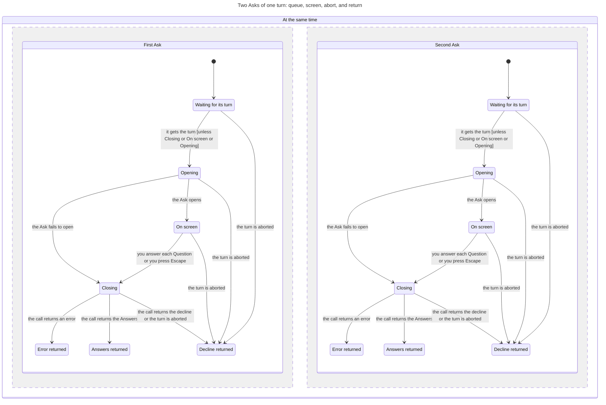

## State chart

This PR adds the verification of the Ask lifecycle, so the chart shows that lifecycle and nothing more.
TLC drew it from a scratch copy of `AskLifecycle.tla` with two Asks in one turn (341 states).
No rule breaks in this chart.

How to read the chart:

- Each region is one `ask_user_question` call of the same turn.
- "it gets the turn [unless Closing or On screen or Opening]" is the queue.
  An Ask opens only when the other Ask does not hold the turn.
- "the turn is aborted" leads to "Decline returned" from each state before the return.
  The abort also closes an Ask that is on screen.
- "the Ask fails to open" leads to "Closing", and the call returns an error.
  The call does not wait for an Answer that the user cannot give.

The chart does not draw steps that stay in one chart state, such as the abort signal before the call reacts to it.
